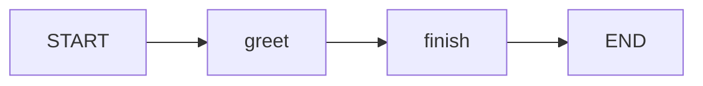
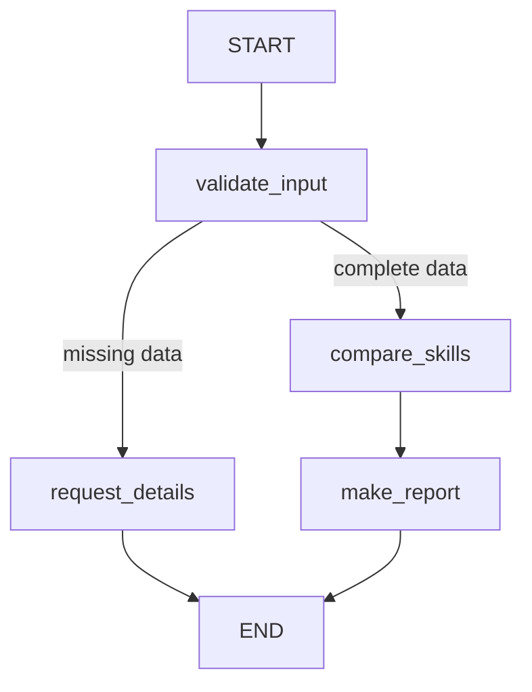
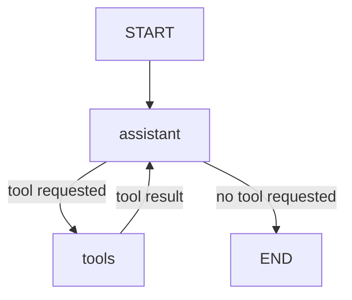

# Lesson 05 — LangGraph from Scratch: Job Skills Analysis

**Level:** Beginner | **Language:** Python | **LLM:** Google Gemini | **Framework:** LangGraph

In Lessons 02–04, we built a tool-using agent using ordinary Python. This lesson introduces **LangGraph** by building a simple graph first, then a **deterministic job-matching workflow**, and finally a **tool-using agent**. These are different patterns: **using LangGraph does not automatically make a workflow agentic**.

## Learning goals

By the end, you can explain **State**, **Nodes**, **Edges**, **START/END**, **conditional routing**, **compile/invoke**, **tool calling**, and **agent loops**. You will also know how to inspect each step in your terminal and explain the architecture in an interview.

## 1. Understand the building blocks

| Concept | Beginner explanation | In our job-matching project |
|---|---|---|
| State | Shared data passed through the graph | Candidate skills, required skills, results |
| Node | A Python function that reads state and returns updates | `compare_skills_node` |
| Edge | Connection between nodes | Comparison → Report |
| Conditional edge | Chooses the next node based on state | Missing requirements → Ask for details |
| `START` | Entry into the graph | Start validation |
| `END` | Graph has finished | Stop after report |
| `StateGraph` | Builder for nodes and edges | Job matching workflow |
| `compile()` | Turns a graph definition into a runnable graph | `graph = builder.compile()` |
| `invoke()` | Runs a graph with initial state | `graph.invoke({...})` |

**Important:** Nodes should normally return *updates* such as `{"match_percentage": 75.0}` instead of modifying the input state in place. LangGraph merges updates into state.

## 2. Setup

Create this folder structure:

```text
lesson-05-langgraph/
├── README.md
├── 01_first_graph.py
├── 02_job_workflow.py
├── 03_gemini_tool_agent.py
├── requirements.txt
├── .env.example
└── .gitignore
```

In a terminal:

```bash
python -m venv .venv
source .venv/bin/activate    # macOS/Linux
# Windows PowerShell: .venv\Scripts\Activate.ps1
python -m pip install -r requirements.txt
```

**`requirements.txt`**

```text
langgraph
langchain-core
langchain-google-genai
python-dotenv
```

**`.env.example`** (copy to `.env`, then edit):

```env
GOOGLE_API_KEY=your_key_here
GEMINI_MODEL=replace_with_a_model_available_to_your_account
```

**`.gitignore`**

```gitignore
.env
.venv/
__pycache__/
*.pyc
```

Use a model that is actually available to your account and supports tool calling. You can obtain an API key from [Google AI Studio](https://aistudio.google.com/apikey). Never commit `.env`.

## 3. First graph: no LLM, no tools

Create **`01_first_graph.py`**:

```python
from typing_extensions import TypedDict
from langgraph.graph import StateGraph, START, END

class State(TypedDict):
    message: str

def greet(state: State):
    print('[NODE] greet | received:', state['message'])
    return {'message': state['message'] + ' I am'}

def finish(state: State):
    print('[NODE] finish | received:', state['message'])
    return {'message': state['message'] + ' learning LangGraph!'}

builder = StateGraph(State)
builder.add_node('greet', greet)
builder.add_node('finish', finish)
builder.add_edge(START, 'greet')
builder.add_edge('greet', 'finish')
builder.add_edge('finish', END)
graph = builder.compile()

result = graph.invoke({'message': 'Hello.'})
print('[FINAL]', result)
```

Run:

```bash
python 01_first_graph.py
```

Expected output:

```text
[NODE] greet | received: Hello.
[NODE] finish | received: Hello. I am
[FINAL] {'message': 'Hello. I am learning LangGraph!'}
```

**Trace:** `START → greet → finish → END`. No LLM makes decisions here: it is a fixed workflow.

## 4. Job skills workflow with conditional routing

We now apply the same ideas to JobHarbor. The graph validates inputs and either asks for missing data or compares skills.

```text
START
  |
  v
validate_input
  |
  +-- missing input --> request_details --> END
  |
  +-- complete ------> compare_skills --> make_report --> END
```

Create **`02_job_workflow.py`**:

```python
from typing_extensions import TypedDict, NotRequired
from langgraph.graph import StateGraph, START, END

class JobState(TypedDict):
    candidate_skills: list[str]
    required_skills: list[str]
    missing_input: NotRequired[bool]
    matched_skills: NotRequired[list[str]]
    missing_skills: NotRequired[list[str]]
    match_percentage: NotRequired[float]
    report: NotRequired[str]

def validate_input(state: JobState):
    missing = not state['candidate_skills'] or not state['required_skills']
    print('[NODE] validate_input | missing:', missing)
    return {'missing_input': missing}

def route_after_validation(state: JobState):
    path = 'request_details' if state['missing_input'] else 'compare_skills'
    print('[ROUTE] ->', path)
    return path

def request_details(state: JobState):
    print('[NODE] request_details')
    return {'report': 'Please provide both your skills and the job requirements.'}

def compare_skills(state: JobState):
    print('[NODE] compare_skills')
    candidate = {s.strip().lower() for s in state['candidate_skills']}
    required = {s.strip().lower() for s in state['required_skills']}
    matched = sorted(candidate & required)
    missing = sorted(required - candidate)
    percentage = round(len(matched) / len(required) * 100, 2)
    return {
        'matched_skills': matched,
        'missing_skills': missing,
        'match_percentage': percentage,
    }

def make_report(state: JobState):
    print('[NODE] make_report')
    return {'report': (
        f"Match: {state['match_percentage']}% | "
        f"Matched: {', '.join(state['matched_skills']) or 'none'} | "
        f"Missing: {', '.join(state['missing_skills']) or 'none'}"
    )}

builder = StateGraph(JobState)
builder.add_node('validate_input', validate_input)
builder.add_node('request_details', request_details)
builder.add_node('compare_skills', compare_skills)
builder.add_node('make_report', make_report)
builder.add_edge(START, 'validate_input')
builder.add_conditional_edges('validate_input', route_after_validation, {
    'request_details': 'request_details',
    'compare_skills': 'compare_skills',
})
builder.add_edge('request_details', END)
builder.add_edge('compare_skills', 'make_report')
builder.add_edge('make_report', END)
graph = builder.compile()

if __name__ == '__main__':
    example = {
        'candidate_skills': ['Python', 'SQL', 'Docker'],
        'required_skills': ['Python', 'SQL', 'Azure', 'Docker'],
    }
    result = graph.invoke(example)
    print('[FINAL]', result['report'])

    print('\n--- Test missing requirements ---')
    missing_result = graph.invoke({
        'candidate_skills': ['Python'],
        'required_skills': [],
    })
    print('[FINAL]', missing_result['report'])
```

Run:

```bash
python 02_job_workflow.py
```

Expected first result: **75%**, matched `docker, python, sql`, missing `azure`. The second test follows the `request_details` branch.

### Why is this not necessarily an AI agent?

The routing function uses ordinary Python logic (`if ... else`). There is **no LLM deciding which tool to use**. This is a useful, reliable **deterministic workflow**. For many production tasks, this is preferable to unnecessary agent autonomy.

## 5. Add an LLM-driven, tool-using agent

Now the **LLM** will decide whether to call `compare_skills`. LangGraph will coordinate the loop.

```text
START → assistant (Gemini)
            |
            +-- tool requested → tools → assistant (repeat)
            |
            +-- no tool requested → END
```

We use LangChain's Gemini integration and LangGraph's `ToolNode` to reduce manual function-call plumbing. This differs from Lesson 03, where we executed calls ourselves.

Create **`03_gemini_tool_agent.py`**:

```python
import os
from dotenv import load_dotenv
from langchain_google_genai import ChatGoogleGenerativeAI
from langchain_core.messages import HumanMessage, SystemMessage
from langchain_core.tools import tool
from langgraph.graph import StateGraph, START, END, MessagesState
from langgraph.prebuilt import ToolNode

load_dotenv()

if not os.getenv('GOOGLE_API_KEY'):
    raise RuntimeError('Set GOOGLE_API_KEY in .env')
model_name = os.getenv('GEMINI_MODEL')
if not model_name:
    raise RuntimeError('Set GEMINI_MODEL in .env')

@tool
def compare_skills(candidate_skills: list[str], required_skills: list[str]) -> dict:
    """Compare candidate technical skills with job requirements; return matches and gaps."""
    print('[ACTION] compare_skills called')
    candidate = {s.strip().lower() for s in candidate_skills}
    required = {s.strip().lower() for s in required_skills}
    if not required:
        return {'error': 'Job requirements cannot be empty.'}
    matched = sorted(candidate & required)
    missing = sorted(required - candidate)
    result = {
        'matched_skills': matched,
        'missing_skills': missing,
        'match_percentage': round(len(matched) / len(required) * 100, 2),
    }
    print('[OBSERVATION] tool result:', result)
    return result

llm = ChatGoogleGenerativeAI(model=model_name, temperature=0)
llm_with_tools = llm.bind_tools([compare_skills])

SYSTEM = SystemMessage(content=(
    'You are a job skills assistant. For skill comparisons, use compare_skills. '
    'Never invent candidate skills or job requirements. '
    'If either list is missing, ask the user to supply it. '
    'Use tool results when reporting a match percentage.'
))

def assistant(state: MessagesState):
    print('[THINK / DECIDE] Calling Gemini; messages:', len(state['messages']))
    response = llm_with_tools.invoke([SYSTEM, *state['messages']])
    print('[MODEL DECISION] tool calls:', [c['name'] for c in response.tool_calls])
    return {'messages': [response]}

def route_after_assistant(state: MessagesState):
    last = state['messages'][-1]
    route = 'tools' if last.tool_calls else 'end'
    print('[ROUTE]', route)
    return route

builder = StateGraph(MessagesState)
builder.add_node('assistant', assistant)
builder.add_node('tools', ToolNode([compare_skills]))
builder.add_edge(START, 'assistant')
builder.add_conditional_edges('assistant', route_after_assistant, {
    'tools': 'tools',
    'end': END,
})
builder.add_edge('tools', 'assistant')
graph = builder.compile()

if __name__ == '__main__':
    question = (
        'My skills are Python, SQL and Docker. '
        'The job requires Python, SQL, Azure and Docker. '
        'Compare my skills.'
    )
    result = graph.invoke(
        {'messages': [HumanMessage(content=question)]},
        config={'recursion_limit': 10},
    )
    print('\n[FINAL ANSWER]')
    print(result['messages'][-1].content)
```

Run:

```bash
python 03_gemini_tool_agent.py
```

**Possible terminal trace** (actual model behavior varies):

```text
[THINK / DECIDE] Calling Gemini; messages: 1
[MODEL DECISION] tool calls: ['compare_skills']
[ROUTE] tools
[ACTION] compare_skills called
[OBSERVATION] tool result: {'matched_skills': ['docker', 'python', 'sql'], 'missing_skills': ['azure'], 'match_percentage': 75.0}
[THINK / DECIDE] Calling Gemini; messages: 3
[MODEL DECISION] tool calls: []
[ROUTE] end
[FINAL ANSWER]
... 75% match ...
```

### Follow the agent loop line by line

1. `MessagesState` holds message history. Its `messages` field uses a reducer that appends new messages rather than replacing the entire history.
2. `assistant()` calls Gemini with system instructions and history.
3. Gemini may return a structured tool-call request.
4. `route_after_assistant()` checks whether the response includes tool calls.
5. `ToolNode` executes registered tools and adds tool-result messages.
6. The edge from `tools` to `assistant` sends the observation back to Gemini.
7. If Gemini requests no tools, the graph reaches `END`.

**Safety note:** This is a learning example. In production, validate tool arguments, enforce tool permissions, handle exceptions, and apply time/token budgets. A recursion limit helps prevent runaway graph execution but is not a complete cost or safety control.

## 6. State vs memory: interview distinction

- **State:** Data used during graph execution (e.g., messages and skill match results).
- **Short-term memory:** State retained across turns, typically through a checkpointer and conversation/thread identifier.
- **Long-term memory:** Data stored for reuse across conversations or sessions, usually in a separate persistent store.

This lesson's `graph.invoke(...)` runs with a fresh input. **It does not provide persistent memory across separate invocations.** Lesson 04's memory concepts still apply, but LangGraph's persistence is a separate feature to add later.

## 7. Debugging and visualization

### See the workflow as a diagram

Open this README in VS Code and choose **Markdown: Open Preview** (or press
`Cmd+Shift+V`). The diagrams below show the nodes and arrows before you run the
code. While running an example, the terminal prints each node in order as
`Step 1`, `Step 2`, and so on.

**01 — Fixed graph**



**02 — Job workflow with a conditional edge**



**03 — Gemini tool-calling agent loop**



Follow the arrows from `START`. The label on a conditional arrow explains why
that route is taken. In the agent graph, Gemini's assistant node either routes
to the tools node and loops back with the result, or finishes at `END`.

For a quick view of the graph structure, add to either graph script after `compile()`:

```python
print(graph.get_graph().draw_mermaid())
```

This prints Mermaid diagram source in the terminal. To render a PNG, use `graph.get_graph().draw_mermaid_png()` when the required rendering dependencies/service are available.

To inspect state updates in a deterministic graph:

```python
for update in graph.stream(example, stream_mode='updates'):
    print('[GRAPH UPDATE]', update)
```

Place this inside `02_job_workflow.py` after `example` is defined. `stream_mode='updates'` shows updates returned by nodes, making execution easier to understand.

**Debugging vocabulary:** `THINK / DECIDE` labels an observable LLM decision step, **not** access to the model's private chain of thought.

## 8. Compare the three approaches

| Approach | Who chooses the next step? | Best use |
|---|---|---|
| Pure Python workflow | Fixed application code | Simple, predictable processes |
| LangGraph deterministic workflow | Graph edges and routing functions | Branching, stateful workflows |
| LangGraph tool-using agent | LLM requests tools; graph enforces execution | Tasks where dynamic tool choice adds value |

For JobHarbor, **CV field extraction** may work best as a structured extraction pipeline, while an **interactive job-advice assistant** may benefit from tool-using agent behavior. Choose agentic control only when its flexibility justifies added complexity.

## 9. Practice exercises

1. In `01_first_graph.py`, add a third node and inspect the order.
2. In `02_job_workflow.py`, try empty required skills; explain which edge is followed.
3. Add `experience_years` and `required_years` to `JobState` and create a `compare_experience` node.
4. In `03_gemini_tool_agent.py`, ask a general question that requires no tool. Check the route.
5. Add a second `@tool` function and see whether Gemini requests it.
6. Print Mermaid output for both graphs and compare their edges.

## 10. Interview questions and answers

**Q1. What is LangGraph?**  
A framework for orchestrating stateful workflows and agent systems as graphs of nodes and edges.

**Q2. What is State?**  
The shared data schema carried through the graph. Nodes read state and return updates.

**Q3. What is a node?**  
A function or runnable that performs a step and typically returns state updates.

**Q4. What is an edge?**  
A connection defining possible execution paths. Conditional edges select paths based on state.

**Q5. What is the difference between `START` and `END`?**  
`START` marks graph entry; `END` marks completion.

**Q6. Why use `compile()`?**  
It converts the builder into an executable graph.

**Q7. What does `ToolNode` do?**  
It runs requested registered tools and returns tool-result messages to graph state.

**Q8. Is every LangGraph application an AI agent?**  
No. LangGraph also supports deterministic workflows with no LLM or tools.

**Q9. How does the tool loop stop?**  
The conditional router sends execution to `END` when the assistant response has no tool calls.

**Q10. Why use LangGraph instead of a manual Python loop?**  
For explicit graph structure, routing, state management, and extensibility as workflows become complex. A small agent may not need it.

## 11. Suggested Git commit

After testing the examples:

```bash
git add lesson-05-langgraph/
git commit -m "feat: teach LangGraph state, routing, and Gemini tool agents"
git push
```

## 12. References

- [LangGraph overview](https://docs.langchain.com/oss/python/langgraph/overview)
- [LangGraph quickstart](https://docs.langchain.com/oss/python/langgraph/quickstart)
- [LangChain Google Gemini integration](https://docs.langchain.com/oss/python/integrations/chat/google_generative_ai)
- [Google AI Studio](https://aistudio.google.com/apikey)

---

### One-minute interview explanation

> I first built a job skills agent using a manual Python tool-calling loop. Then I rebuilt it using LangGraph. I defined state to track messages, an assistant node to call Gemini, a ToolNode to execute approved Python tools, and conditional edges to loop back after tool observations or finish when no tools are requested. I also built a separate deterministic graph to demonstrate that not every LangGraph workflow needs an agent.
